# Lectura de imágenes

La imagen a color se compara con su conversión a escala de grises y con los canales azul, verde y rojo por separado.

## Caballo

| Original | Escala de grises |
|:---:|:---:|
| 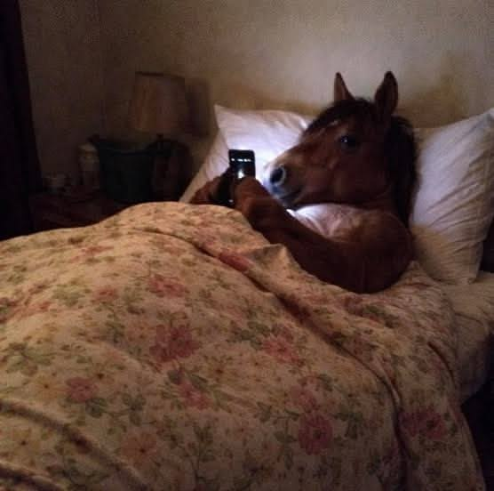 | 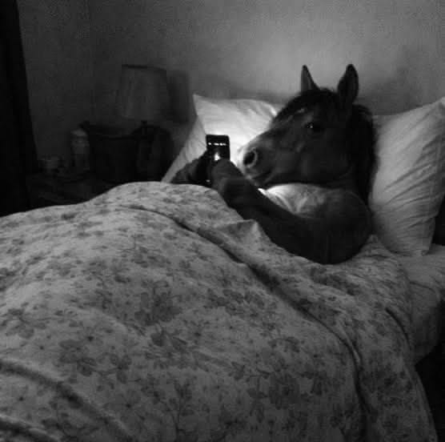 |

| Canal azul: intensidad | Canal verde: intensidad | Canal rojo: intensidad |
|:---:|:---:|:---:|
|  | 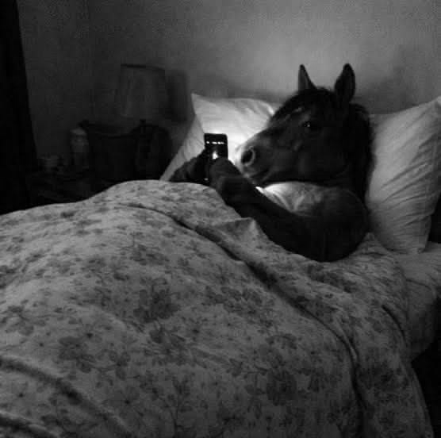 | 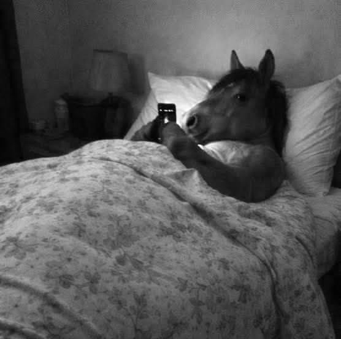 |

| Azul coloreado | Verde coloreado | Rojo coloreado |
|:---:|:---:|:---:|
| 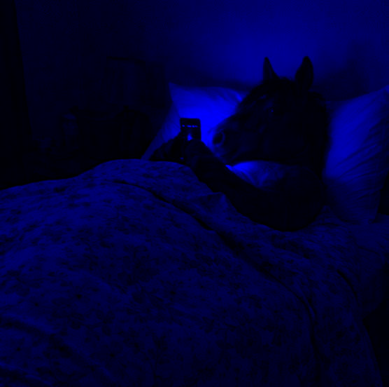 | 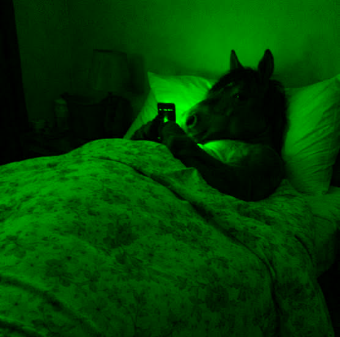 | 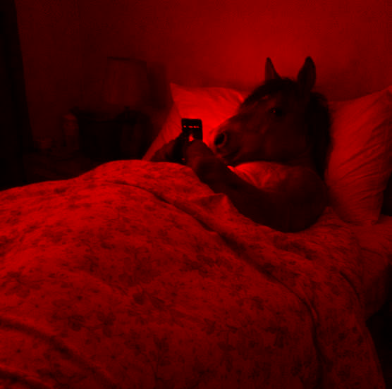 |

## Gato

| Original | Escala de grises |
|:---:|:---:|
|  |  |

| Canal azul: intensidad | Canal verde: intensidad | Canal rojo: intensidad |
|:---:|:---:|:---:|
| 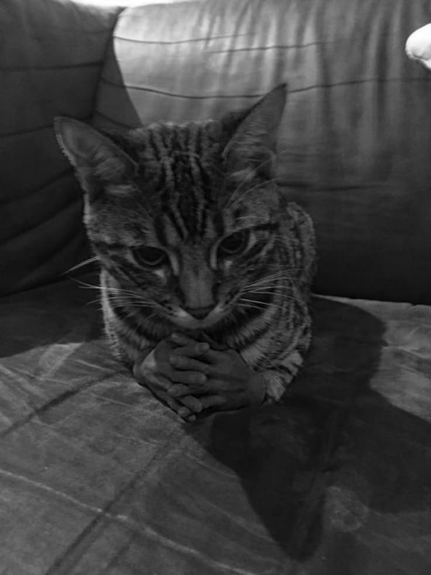 |  | 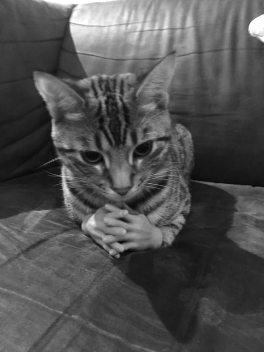 |

| Azul coloreado | Verde coloreado | Rojo coloreado |
|:---:|:---:|:---:|
| 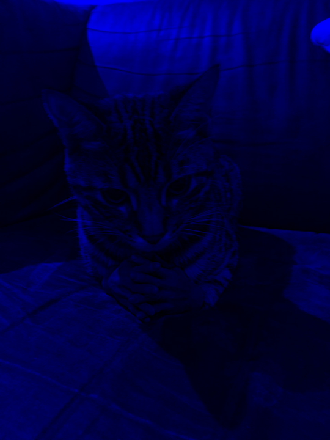 | 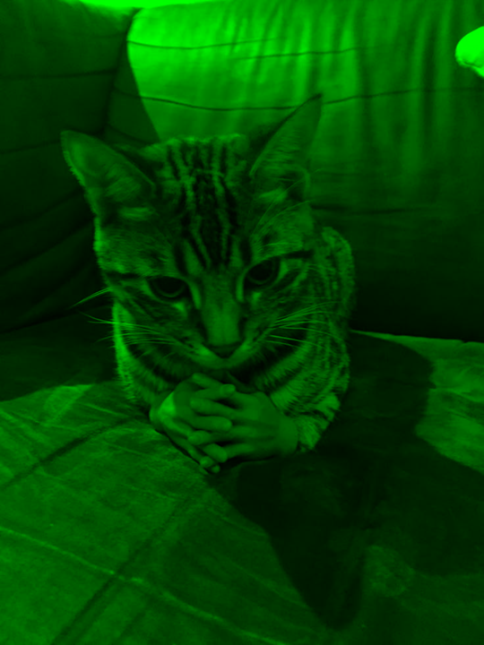 | 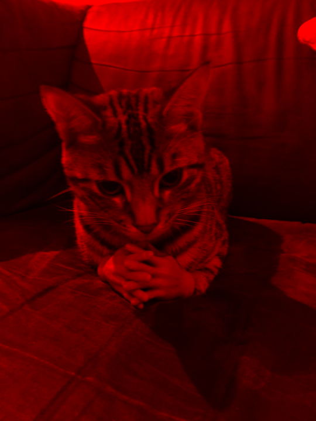 |

## Perro

| Original | Escala de grises |
|:---:|:---:|
| 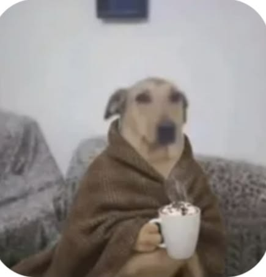 |  |

| Canal azul: intensidad | Canal verde: intensidad | Canal rojo: intensidad |
|:---:|:---:|:---:|
|  |  |  |

| Azul coloreado | Verde coloreado | Rojo coloreado |
|:---:|:---:|:---:|
|  | 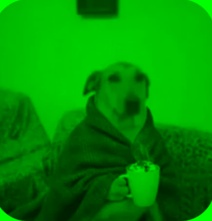 | 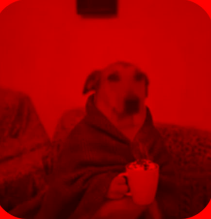 |

## Vacas

| Original | Escala de grises |
|:---:|:---:|
| 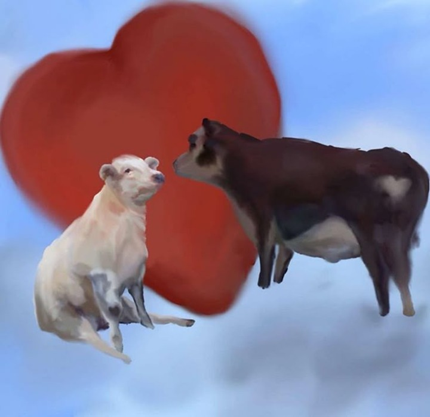 |  |

| Canal azul: intensidad | Canal verde: intensidad | Canal rojo: intensidad |
|:---:|:---:|:---:|
|  |  | 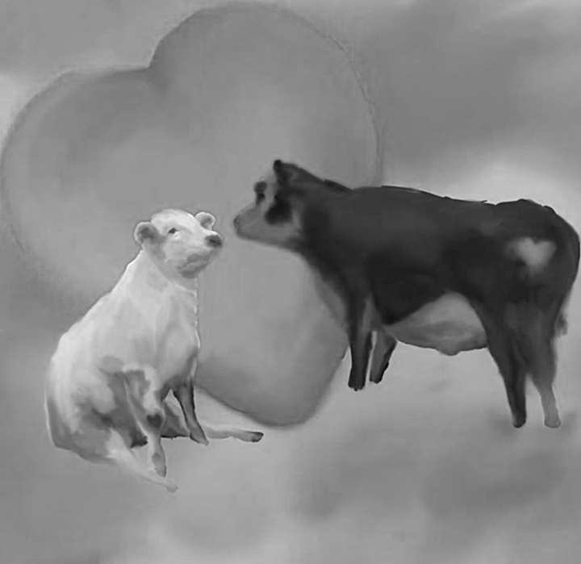 |

| Azul coloreado | Verde coloreado | Rojo coloreado |
|:---:|:---:|:---:|
| 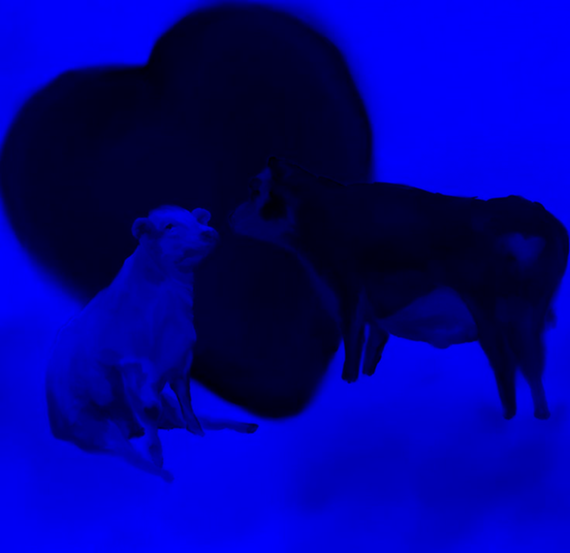 |  | 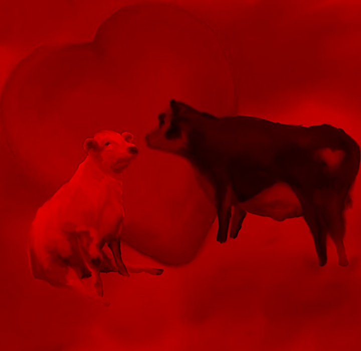 |

Las intensidades se muestran en gris y sus vistas coloreadas aíslan cada componente: en vacas, el fondo destaca en azul y el corazón en rojo.
