# Transformaciones geométricas

Traslación, rotación, escala y reflexión cambian la posición y orientación de la imagen; las transformaciones afines y de perspectiva también modifican su geometría.

## Caballo

| Original | Traslación | Rotación de 30° |
|:---:|:---:|:---:|
|  |  |  |

| Escala horizontal y vertical | Reflexión horizontal | Reflexión vertical |
|:---:|:---:|:---:|
| 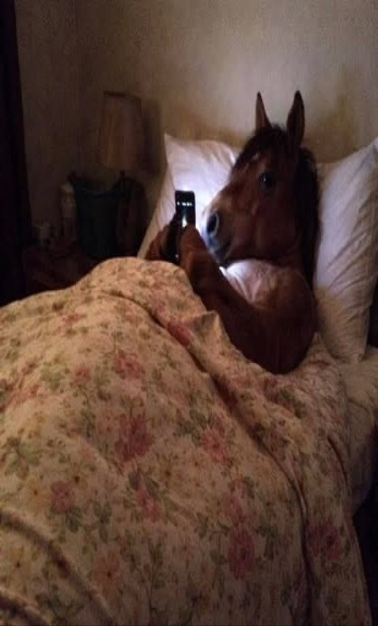 | 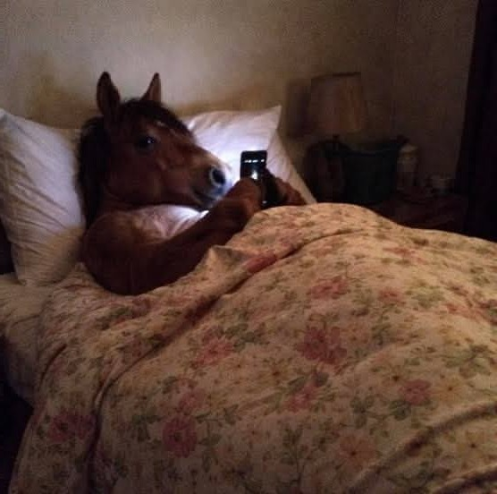 |  |

| Original | Cizalla horizontal | Cizalla vertical |
|:---:|:---:|:---:|
|  | 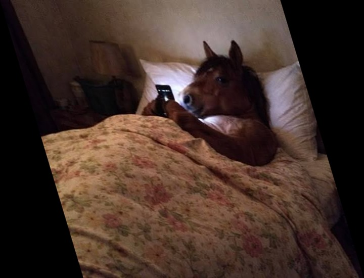 |  |

| Original | Afín de tres puntos | Perspectiva |
|:---:|:---:|:---:|
|  | 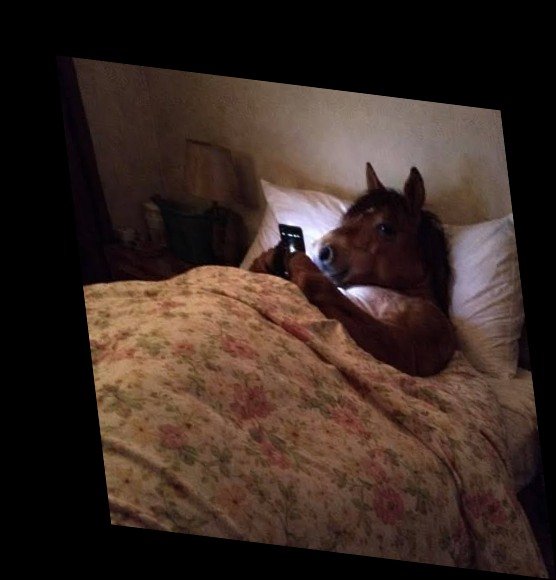 |  |

## Gato

| Original | Traslación | Rotación de 30° |
|:---:|:---:|:---:|
|  | 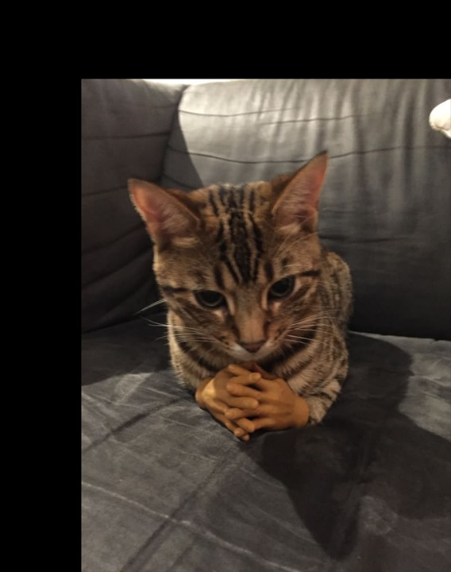 | 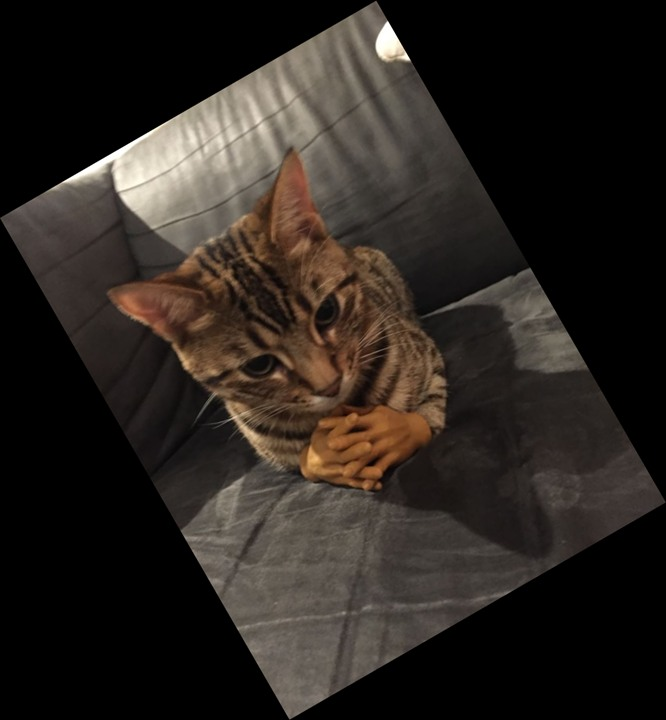 |

| Escala horizontal y vertical | Reflexión horizontal | Reflexión vertical |
|:---:|:---:|:---:|
| 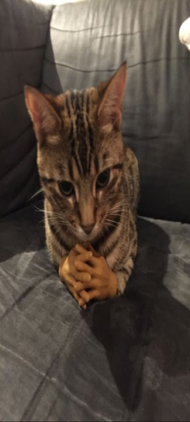 | 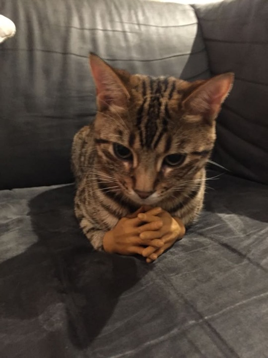 | 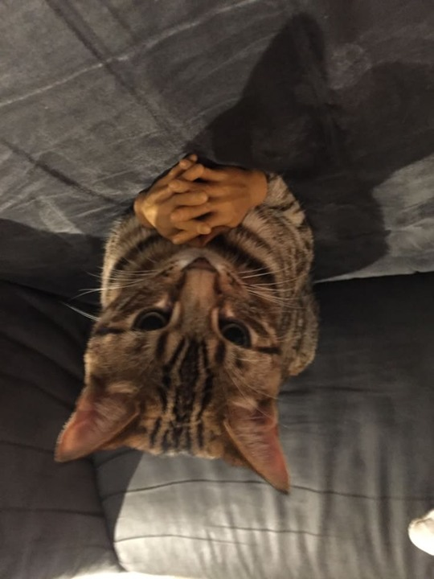 |

| Original | Cizalla horizontal | Cizalla vertical |
|:---:|:---:|:---:|
|  | 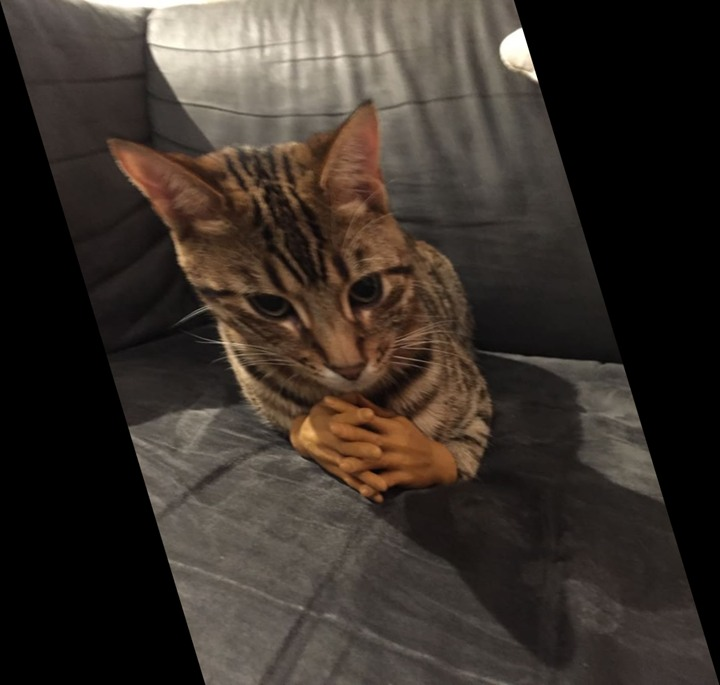 | 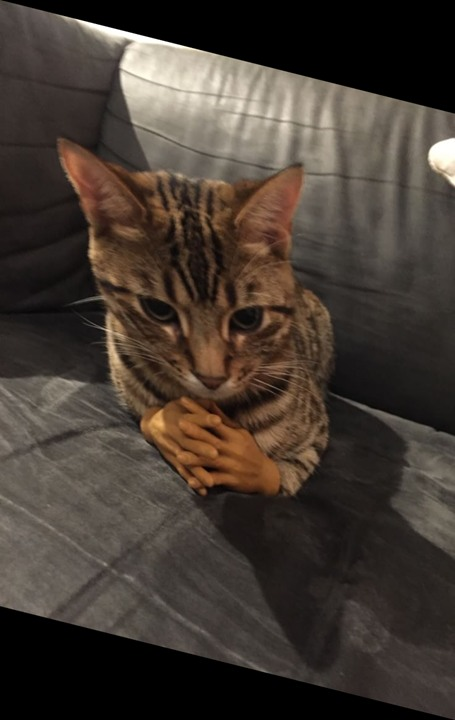 |

| Original | Afín de tres puntos | Perspectiva |
|:---:|:---:|:---:|
|  | 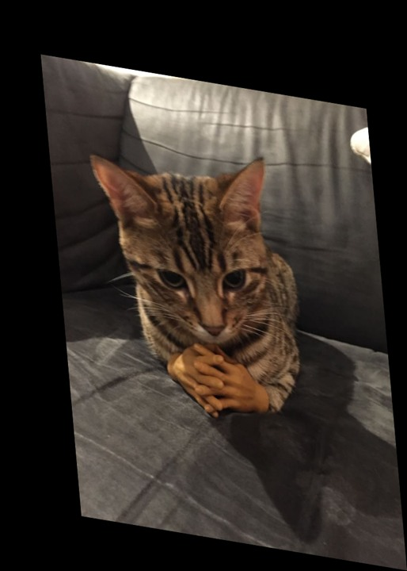 | 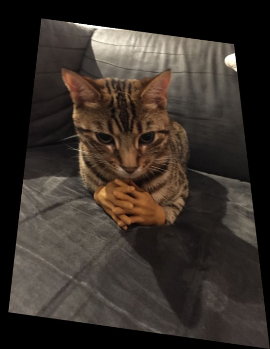 |

## Perro

| Original | Traslación | Rotación de 30° |
|:---:|:---:|:---:|
|  |  | 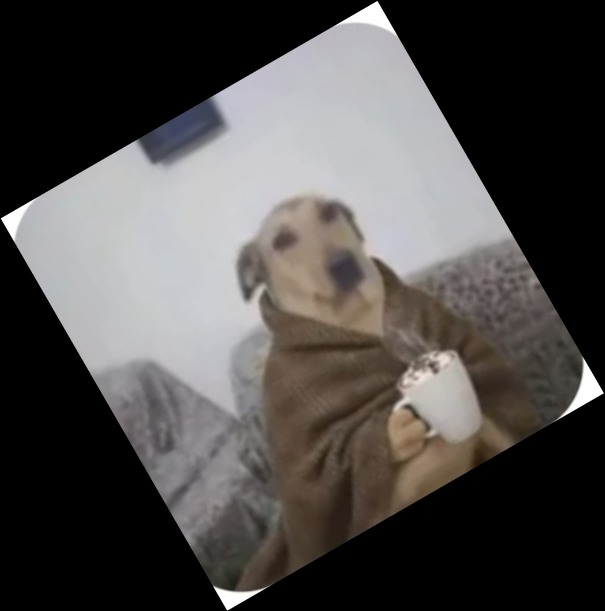 |

| Escala horizontal y vertical | Reflexión horizontal | Reflexión vertical |
|:---:|:---:|:---:|
|  |  |  |

| Original | Cizalla horizontal | Cizalla vertical |
|:---:|:---:|:---:|
|  | 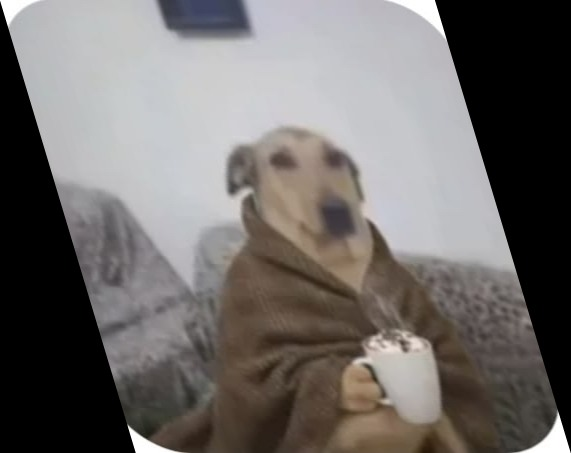 |  |

| Original | Afín de tres puntos | Perspectiva |
|:---:|:---:|:---:|
|  | 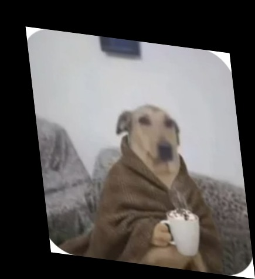 | 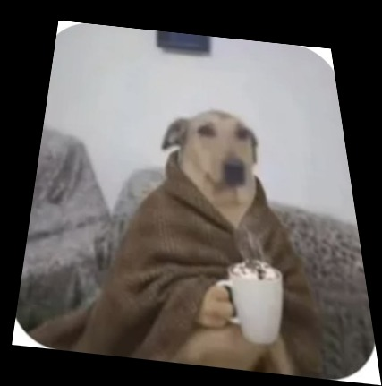 |

## Vacas

| Original | Traslación | Rotación de 30° |
|:---:|:---:|:---:|
|  | 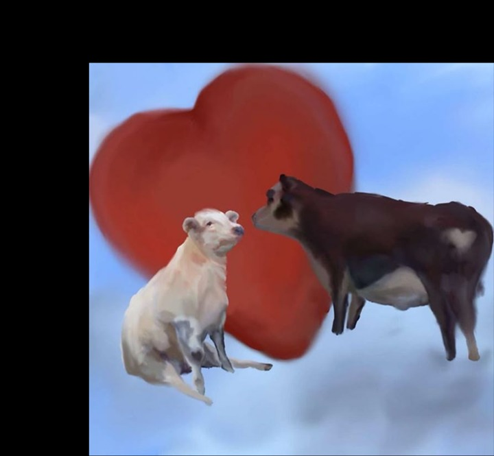 |  |

| Escala horizontal y vertical | Reflexión horizontal | Reflexión vertical |
|:---:|:---:|:---:|
| 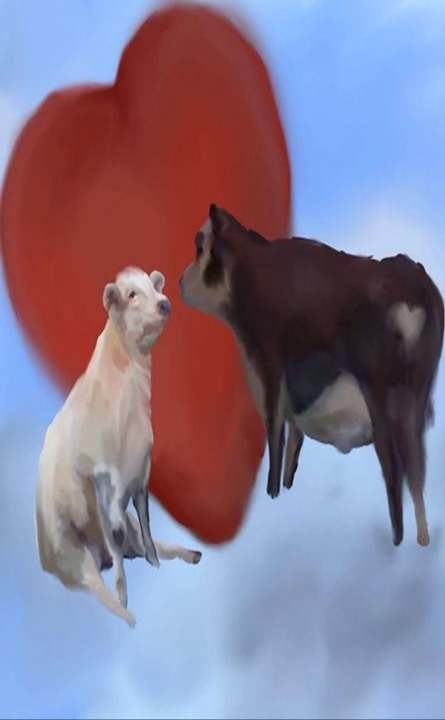 |  | 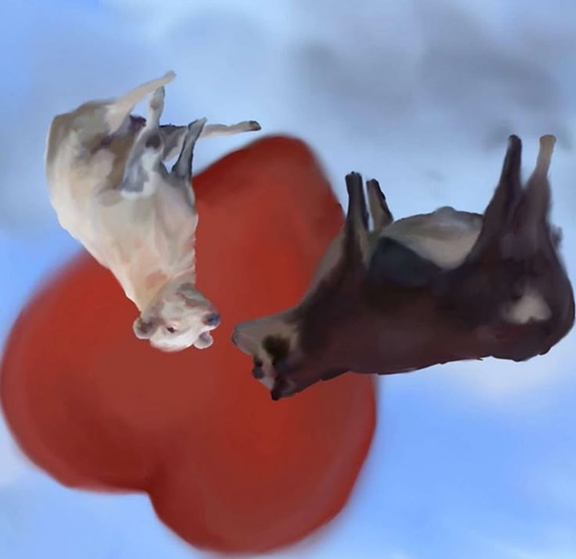 |

| Original | Cizalla horizontal | Cizalla vertical |
|:---:|:---:|:---:|
|  |  | 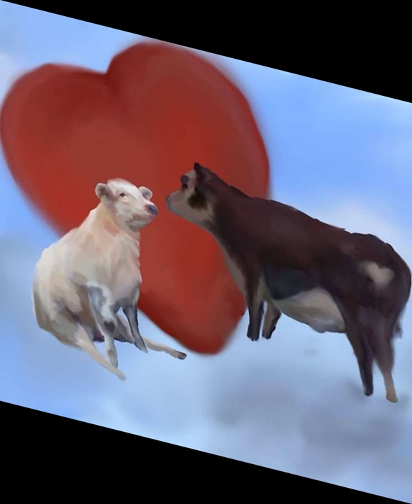 |

| Original | Afín de tres puntos | Perspectiva |
|:---:|:---:|:---:|
|  |  |  |

La escala no uniforme cambia las proporciones, las reflexiones invierten la orientación y las cizallas inclinan la imagen.
