# Calibración de cámara

Las esquinas de un tablero sirven para estimar el modelo de cada cámara y corregir la distorsión de sus imágenes.

## iPhone

| Original | Esquinas detectadas | Corrección de distorsión |
|:---:|:---:|:---:|
|  | 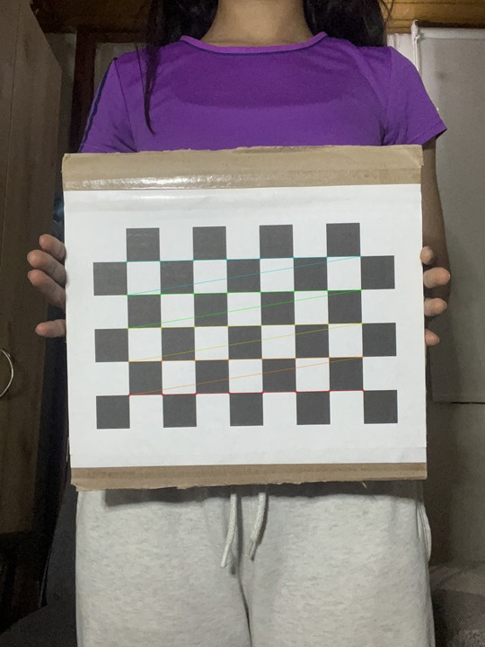 | 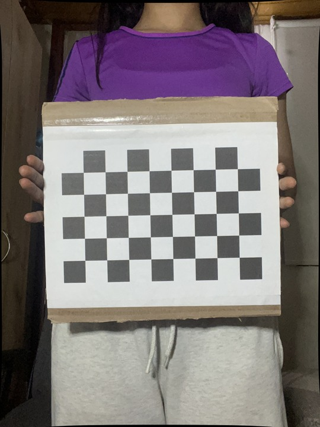 |
| 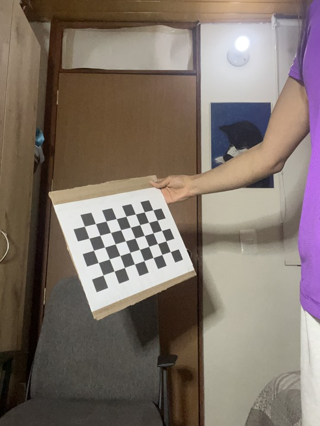 |  | 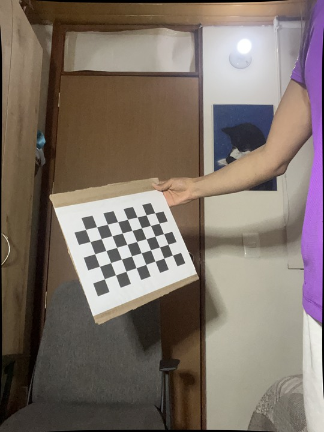 |
| 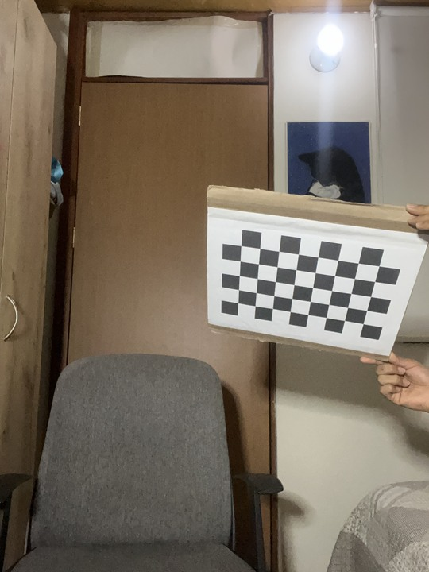 |  | 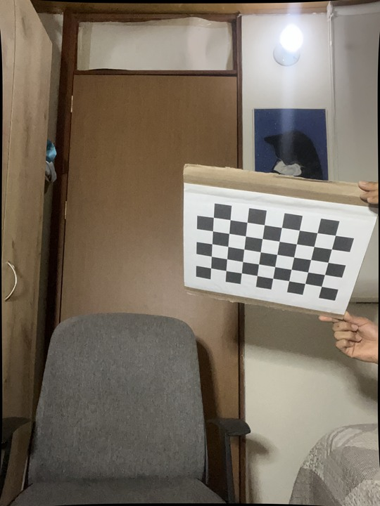 |

Las marcas siguen las esquinas internas del tablero en distintas posiciones.

## Tablet

| Original | Esquinas detectadas | Corrección de distorsión |
|:---:|:---:|:---:|
|  | 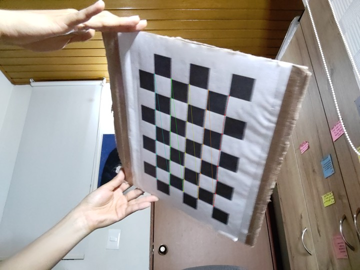 | 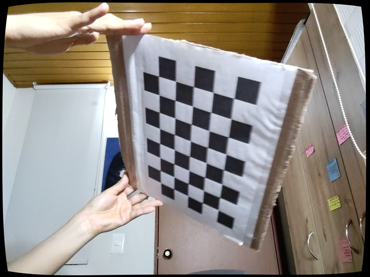 |
|  | 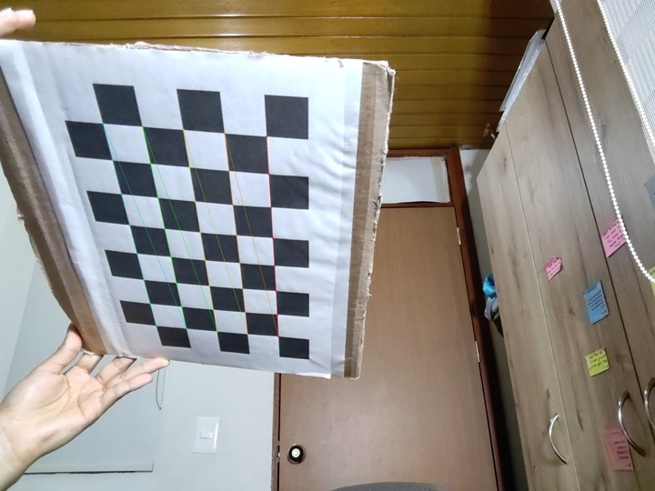 | 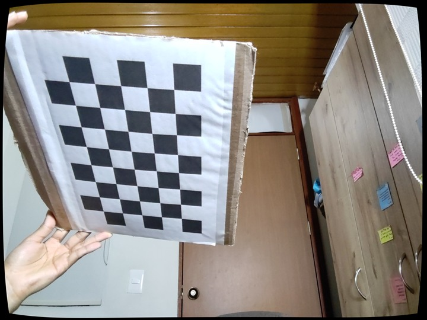 |
|  | 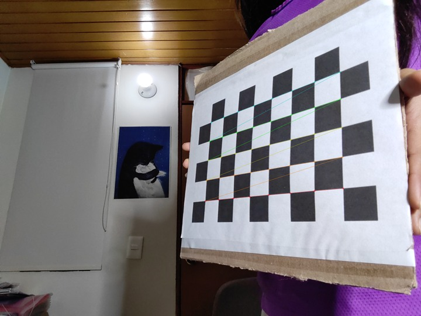 | 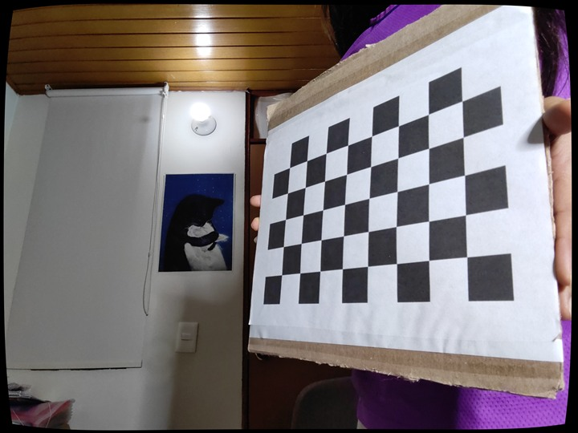 |

La corrección modifica la distorsión de los bordes y conserva la inclinación de cada toma.
