# Filtros espaciales

Los filtros de suavizado reducen variaciones locales, los de enfoque realzan detalles y los operadores de bordes resaltan cambios de intensidad.

## Caballo

### Suavizado

| Original | Caja 3×3 | Gaussiano 5×5 |
|:---:|:---:|:---:|
|  |  |  |

| Mediana 5×5 | Mínimo 5×5 | Máximo 5×5 |
|:---:|:---:|:---:|
|  |  |  |

El suavizado reduce variaciones locales; mínimo y máximo expanden regiones oscuras y claras, respectivamente.

### Enfoque

| Original | Enfoque | Máscara de realce |
|:---:|:---:|:---:|
|  |  | 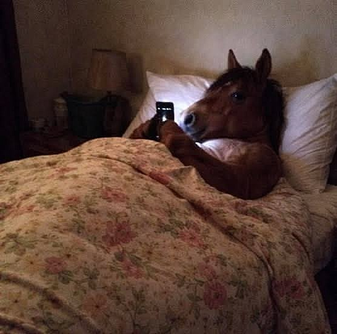 |

El enfoque acentúa las transiciones y la máscara de realce resalta detalles.

### Detección de bordes

| Sobel X | Sobel Y | Magnitud de Sobel |
|:---:|:---:|:---:|
| 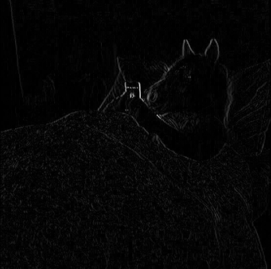 |  |  |

| Prewitt | Roberts | Laplaciano |
|:---:|:---:|:---:|
|  |  | 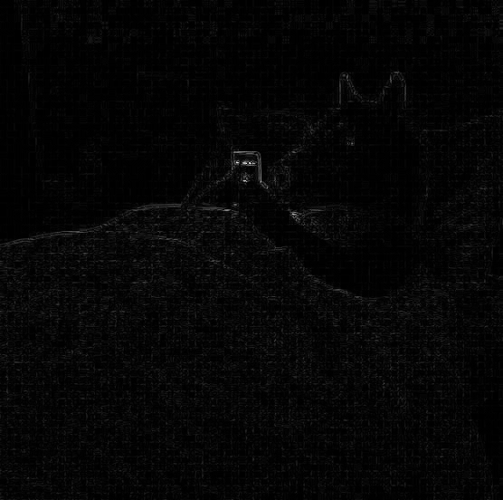 |

| Original | Canny |
|:---:|:---:|
|  | 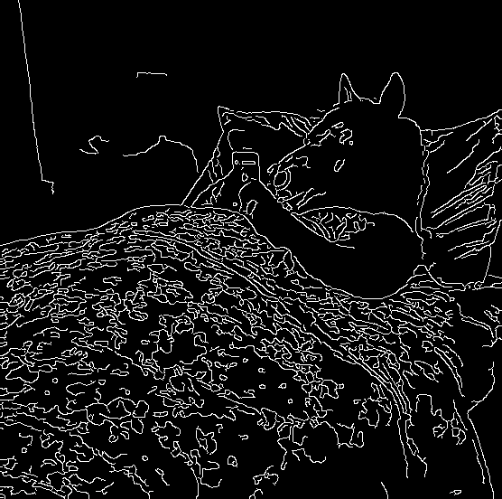 |

Las derivadas muestran cambios de intensidad; Canny deja contornos binarios.

## Gato

### Suavizado

| Original | Caja 3×3 | Gaussiano 5×5 |
|:---:|:---:|:---:|
|  |  |  |

| Mediana 5×5 | Mínimo 5×5 | Máximo 5×5 |
|:---:|:---:|:---:|
|  |  |  |

### Enfoque

| Original | Enfoque | Máscara de realce |
|:---:|:---:|:---:|
|  |  |  |

### Detección de bordes

| Sobel X | Sobel Y | Magnitud de Sobel |
|:---:|:---:|:---:|
|  |  | 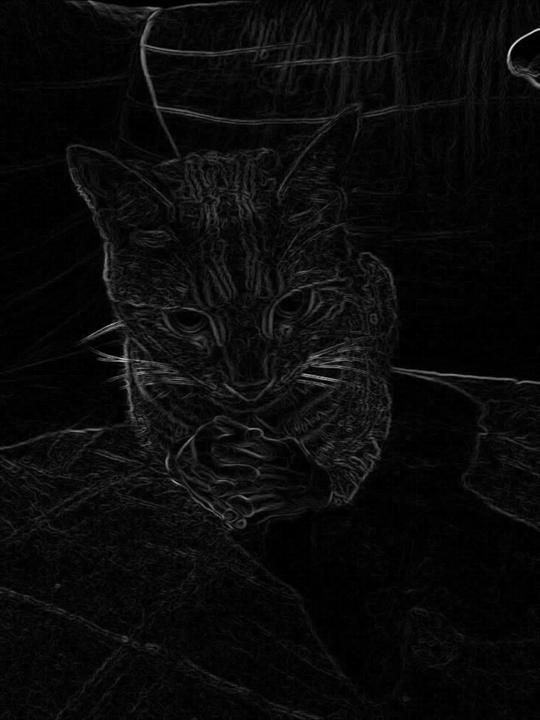 |

| Prewitt | Roberts | Laplaciano |
|:---:|:---:|:---:|
|  |  | 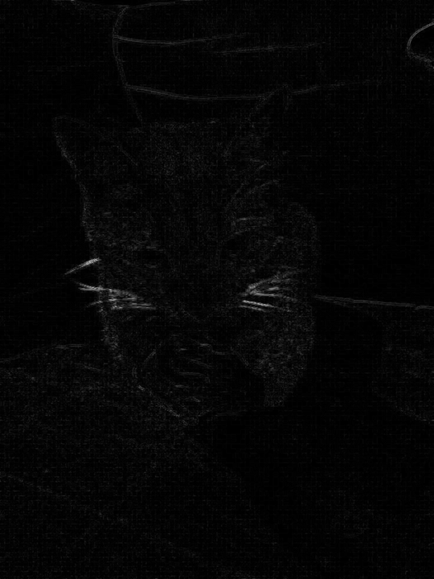 |

| Original | Canny |
|:---:|:---:|
|  |  |

## Perro

### Suavizado

| Original | Caja 3×3 | Gaussiano 5×5 |
|:---:|:---:|:---:|
|  |  |  |

| Mediana 5×5 | Mínimo 5×5 | Máximo 5×5 |
|:---:|:---:|:---:|
|  |  |  |

### Enfoque

| Original | Enfoque | Máscara de realce |
|:---:|:---:|:---:|
|  |  |  |

### Detección de bordes

| Sobel X | Sobel Y | Magnitud de Sobel |
|:---:|:---:|:---:|
|  |  |  |

| Prewitt | Roberts | Laplaciano |
|:---:|:---:|:---:|
|  | 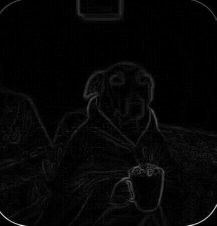 |  |

| Original | Canny |
|:---:|:---:|
|  |  |

## Vacas

### Suavizado

| Original | Caja 3×3 | Gaussiano 5×5 |
|:---:|:---:|:---:|
|  |  |  |

| Mediana 5×5 | Mínimo 5×5 | Máximo 5×5 |
|:---:|:---:|:---:|
|  | 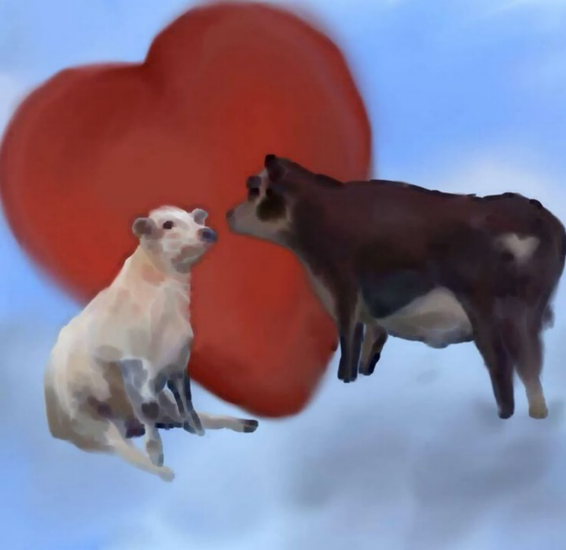 | 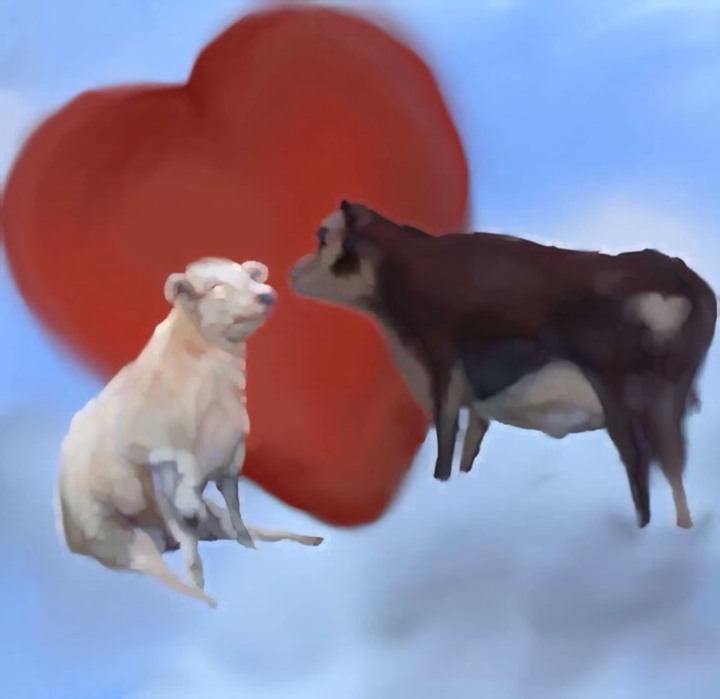 |

### Enfoque

| Original | Enfoque | Máscara de realce |
|:---:|:---:|:---:|
|  |  |  |

### Detección de bordes

| Sobel X | Sobel Y | Magnitud de Sobel |
|:---:|:---:|:---:|
| 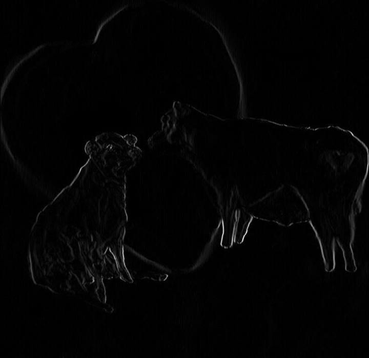 | 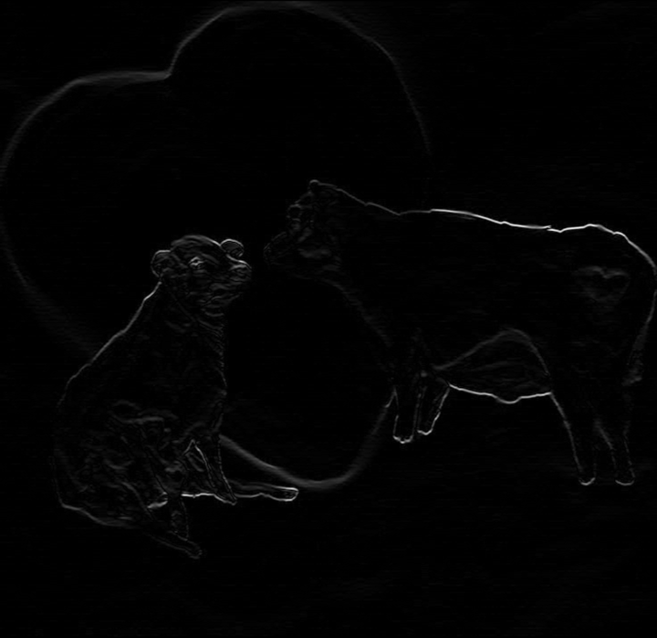 |  |

| Prewitt | Roberts | Laplaciano |
|:---:|:---:|:---:|
| 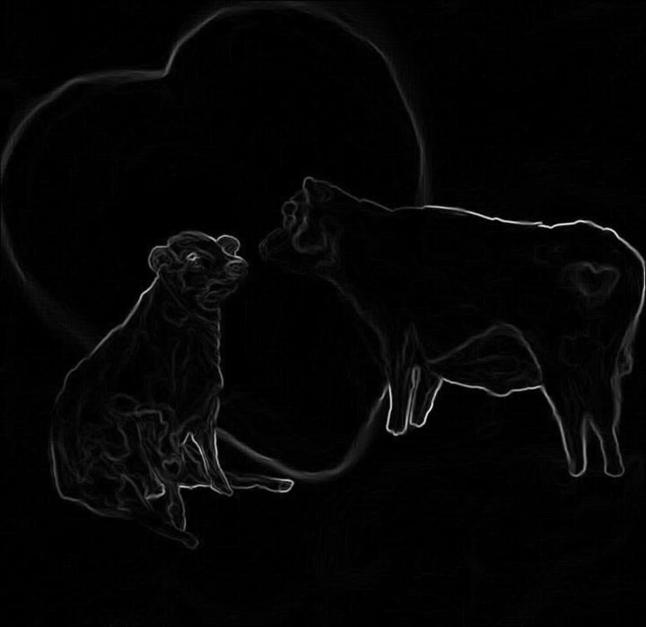 |  | 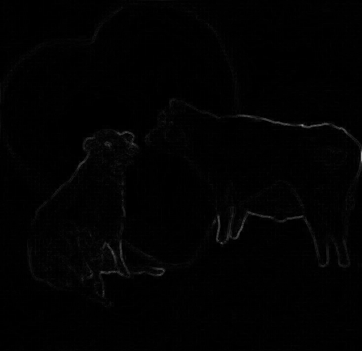 |

| Original | Canny |
|:---:|:---:|
|  |  |
