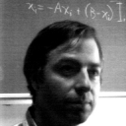
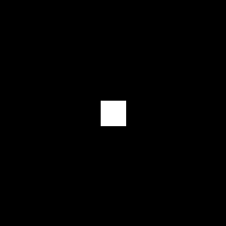
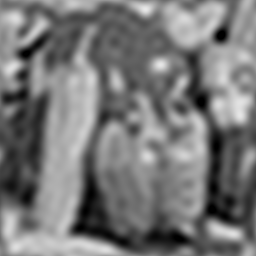

# Filtros en frecuencia

La transformada de Fourier y las máscaras espectrales permiten filtrar las frecuencias de una imagen y reconstruirla con distintos niveles de detalle.

## Lehar

| Original | Espectro de Fourier |
|:---:|:---:|
|  |  |

| Máscara | Vista de la máscara | Reconstrucción |
|:---:|:---:|:---:|
| mask1: disco pequeño |  |  |
| mask2: disco grande |  |  |
| mask3: cuadrado pequeño |  |  |
| mask4: cuadrado grande |  |  |

## Lena

| Original | Espectro de Fourier |
|:---:|:---:|
|  |  |

| Máscara | Vista de la máscara | Reconstrucción |
|:---:|:---:|:---:|
| mask1: disco pequeño |  |  |
| mask2: disco grande |  |  |
| mask3: cuadrado pequeño |  |  |
| mask4: cuadrado grande |  |  |

## Peppers

| Original | Espectro de Fourier |
|:---:|:---:|
|  |  |

| Máscara | Vista de la máscara | Reconstrucción |
|:---:|:---:|:---:|
| mask1: disco pequeño |  |  |
| mask2: disco grande |  |  |
| mask3: cuadrado pequeño |  |  |
| mask4: cuadrado grande |  |  |

Las máscaras pequeñas suavizan más la imagen; las grandes conservan mejor los detalles.

## Sin1

| Original | Espectro de Fourier |
|:---:|:---:|
|  |  |

| Máscara | Vista de la máscara | Reconstrucción |
|:---:|:---:|:---:|
| mask1: disco pequeño |  |  |
| mask2: disco grande |  |  |
| mask3: cuadrado pequeño |  |  |
| mask4: cuadrado grande |  |  |

Las cuatro máscaras conservan el patrón principal de franjas.
