# Histogramas y umbralización

Los histogramas describen la distribución del color o la intensidad; la ecualización modifica el contraste y los umbrales separan regiones claras y oscuras.

## Mango

### Histogramas y ecualización

| Original | Histograma |
|:---:|:---:|
| 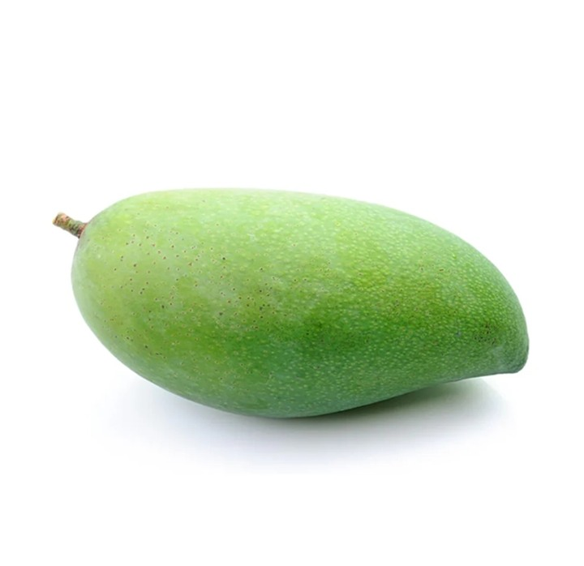 | 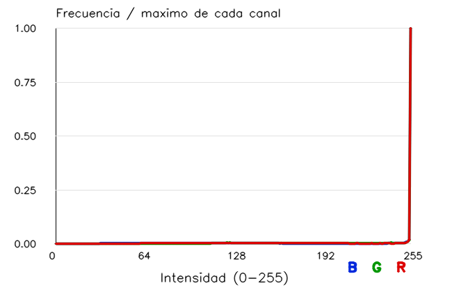 |

| Histograma azul | Histograma verde | Histograma rojo |
|:---:|:---:|:---:|
| 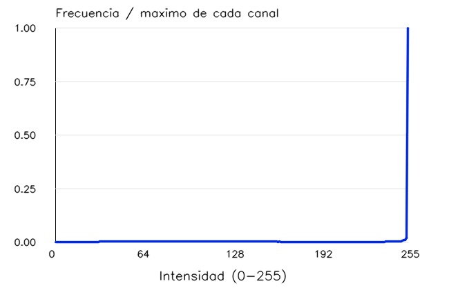 | 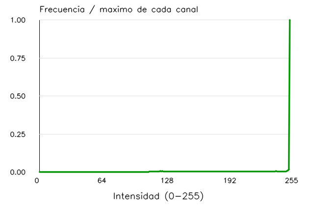 | 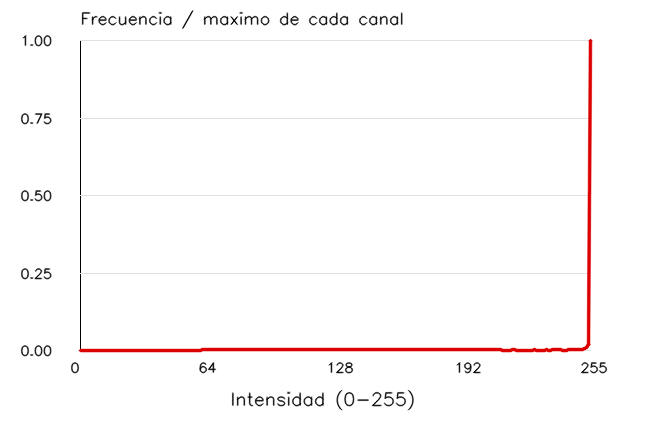 |

| Original a color | Ecualización de luminancia |
|:---:|:---:|
|  | 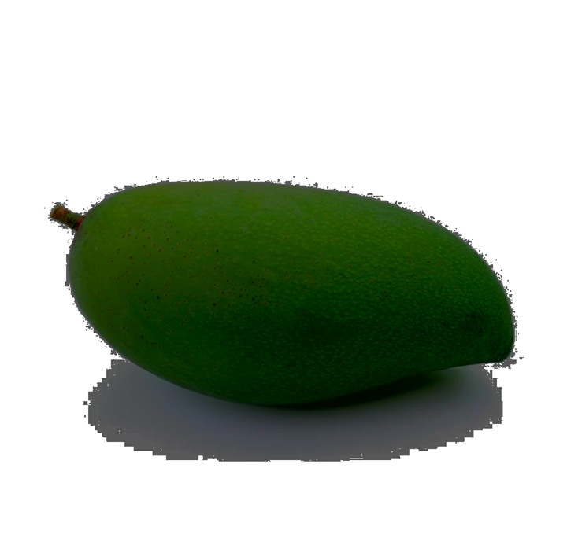 |

| Escala de grises | Ecualizada en gris |
|:---:|:---:|
| 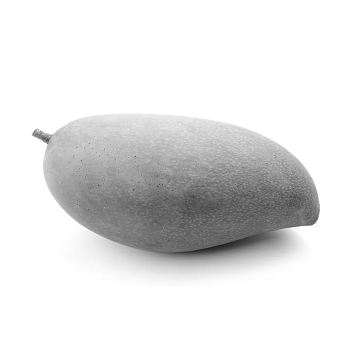 | 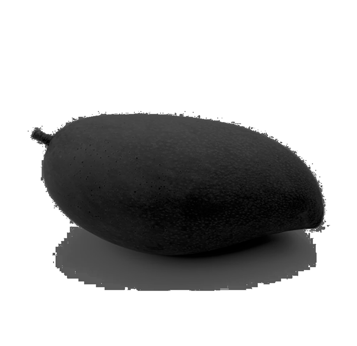 |

| Histograma de intensidad original | Histograma ecualizado |
|:---:|:---:|
| 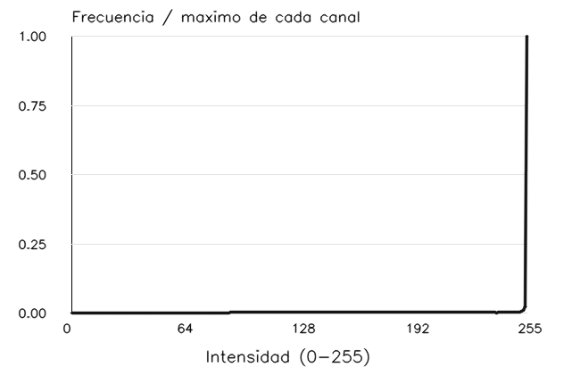 | 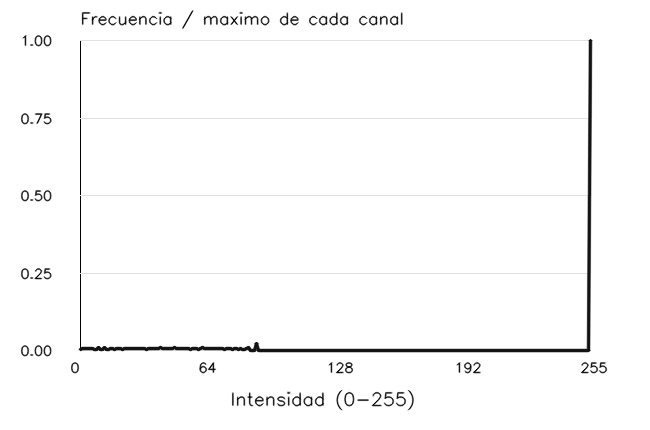 |

### Umbralización

| Original en gris | Otsu | Adaptativa por media |
|:---:|:---:|:---:|
|  | 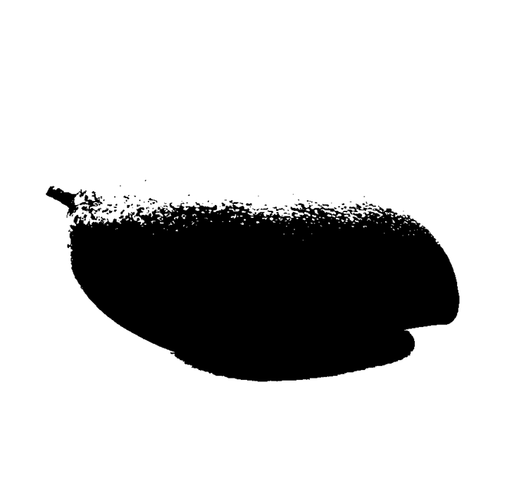 | 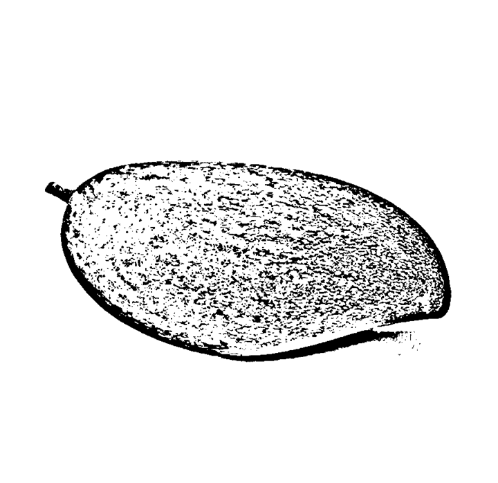 |

| Original en gris | Adaptativa gaussiana |
|:---:|:---:|
|  | 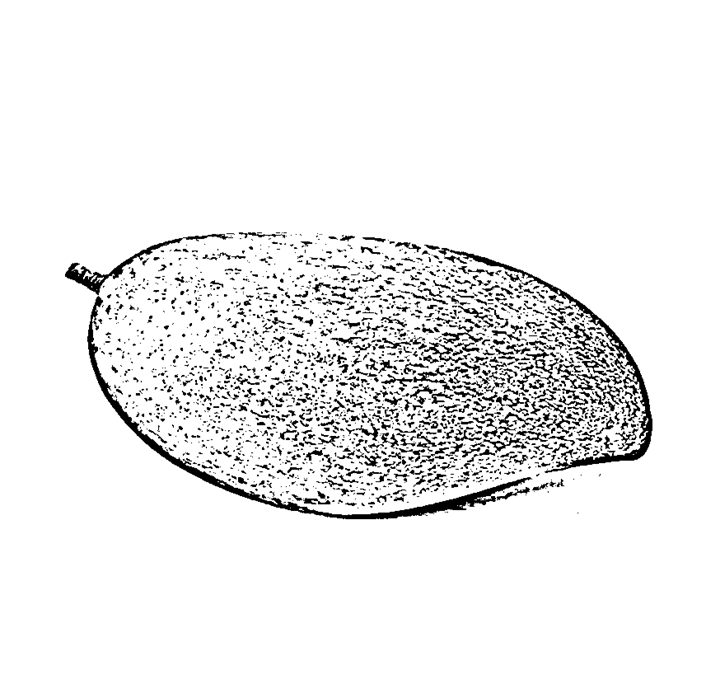 |

## Camaraman

### Histogramas y ecualización

| Original | Histograma |
|:---:|:---:|
| 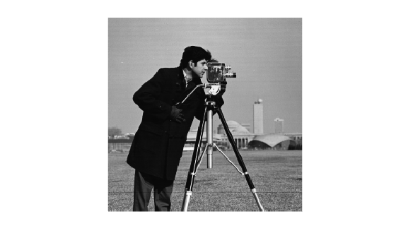 | 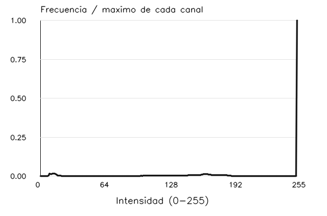 |

| Original | Ecualizada en gris |
|:---:|:---:|
|  | 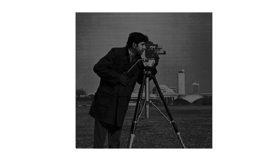 |

| Histograma de intensidad original | Histograma ecualizado |
|:---:|:---:|
|  | 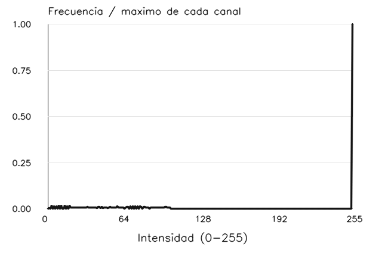 |

### Umbralización

| Original en gris | Otsu | Adaptativa por media |
|:---:|:---:|:---:|
|  | 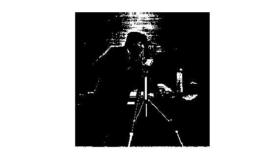 | 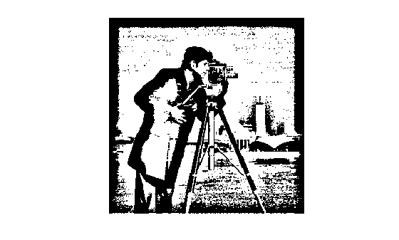 |

| Original en gris | Adaptativa gaussiana |
|:---:|:---:|
|  | 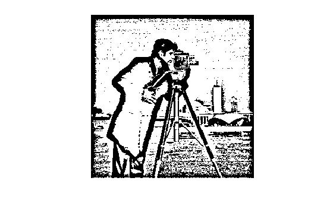 |

## Coins

### Histogramas y ecualización

| Original | Histograma |
|:---:|:---:|
| 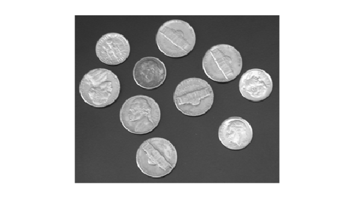 | 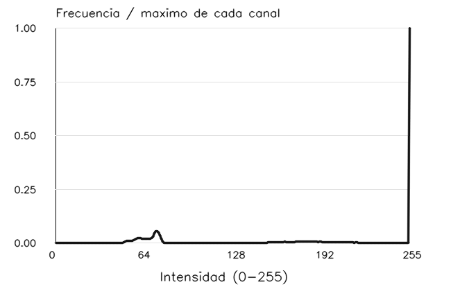 |

| Original | Ecualizada en gris |
|:---:|:---:|
|  | 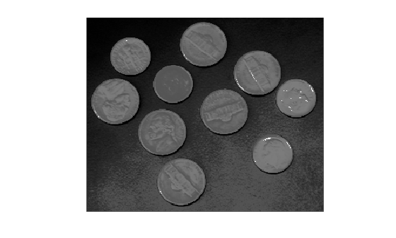 |

| Histograma de intensidad original | Histograma ecualizado |
|:---:|:---:|
|  | 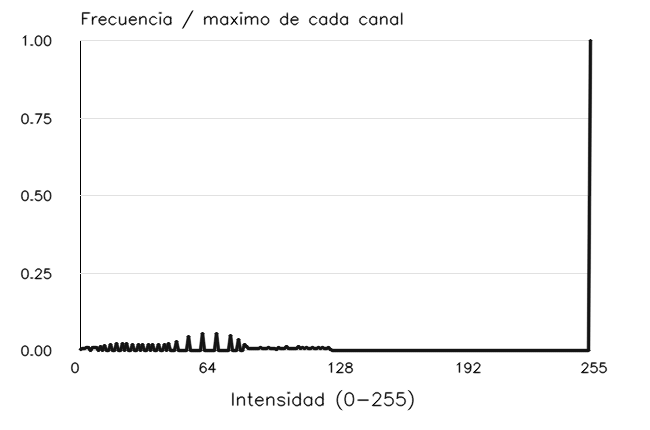 |

El marco blanco concentra gran parte del histograma; tras la ecualización, las monedas quedan más oscuras y aparece más textura en el fondo.

### Umbralización

| Original en gris | Otsu | Adaptativa por media |
|:---:|:---:|:---:|
|  | 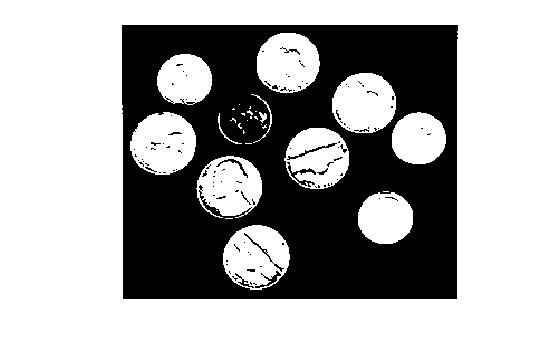 | 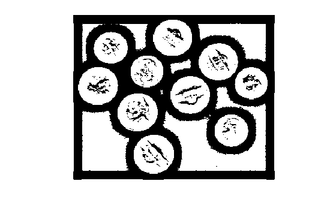 |

| Original en gris | Adaptativa gaussiana |
|:---:|:---:|
|  | 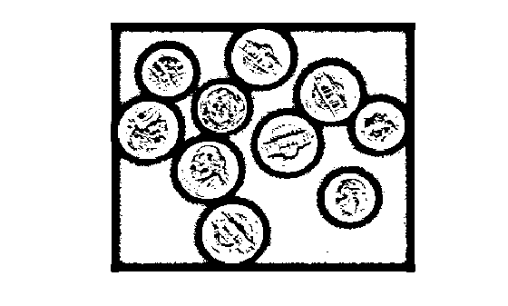 |

Otsu forma regiones más uniformes; los métodos adaptativos conservan detalles locales y también resaltan textura.
