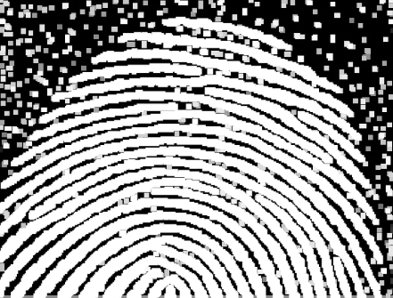
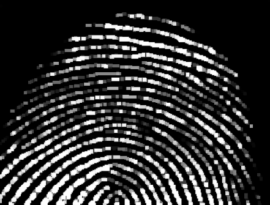
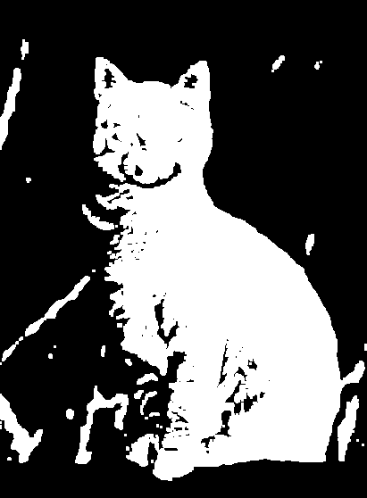
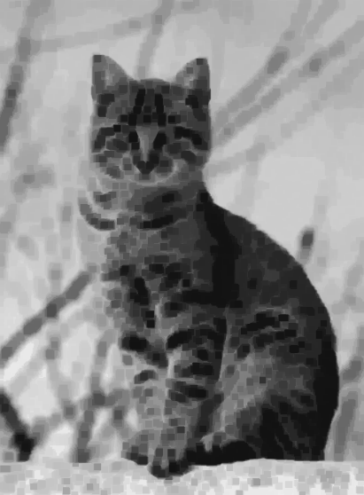
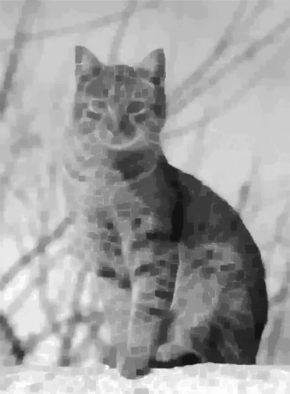

# Morfología matemática

Erosión, dilatación, apertura y cierre comparan las regiones blancas y los cambios de intensidad en las representaciones binaria y gris.

## Huella

### Binaria · rectangular 3×3

| Original binaria | Erosión | Dilatación |
|:---:|:---:|:---:|
|  |  |  |

| Apertura | Cierre |
|:---:|:---:|
|  |  |

La erosión adelgaza las crestas, la dilatación reduce los huecos y el cierre une algunas separaciones pequeñas.

### Escala de grises · rectangular 5×5

| Original en gris | Erosión | Dilatación |
|:---:|:---:|:---:|
|  |  |  |

| Apertura | Cierre |
|:---:|:---:|
|  |  |

## Letra

### Binaria · rectangular 3×3

| Original binaria | Erosión | Dilatación |
|:---:|:---:|:---:|
|  |  |  |

| Apertura | Cierre |
|:---:|:---:|
|  |  |

En la letra, la apertura suaviza salientes del trazo; la dilatación lo engrosa y la erosión lo afina.

### Escala de grises · rectangular 3×3

| Original en gris | Erosión | Dilatación |
|:---:|:---:|:---:|
|  |  |  |

| Apertura | Cierre |
|:---:|:---:|
|  |  |

La versión gris coincide con la binaria porque la entrada solo contiene negro y blanco.

## Cat

### Binaria · rectangular 3×3

| Original binaria | Erosión | Dilatación |
|:---:|:---:|:---:|
|  |  |  |

| Apertura | Cierre |
|:---:|:---:|
|  |  |

### Escala de grises · rectangular 7×7

| Original en gris | Erosión | Dilatación |
|:---:|:---:|:---:|
|  |  |  |

| Apertura | Cierre |
|:---:|:---:|
|  |  |

En gris, la erosión extiende las zonas oscuras y la dilatación expande las claras.
